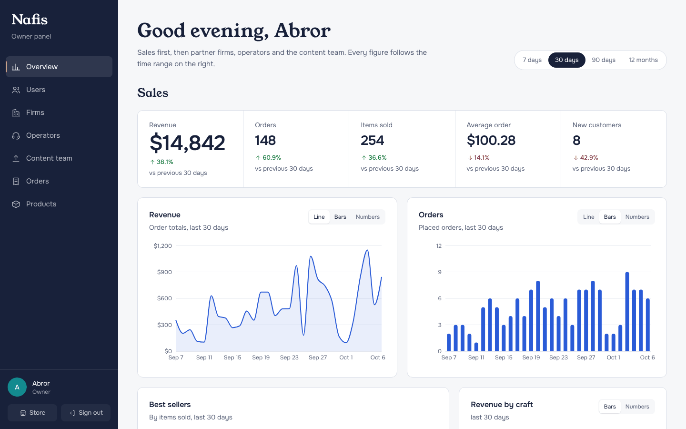
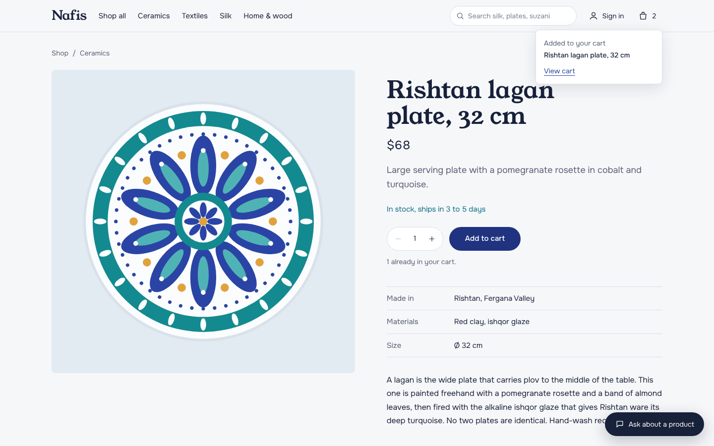
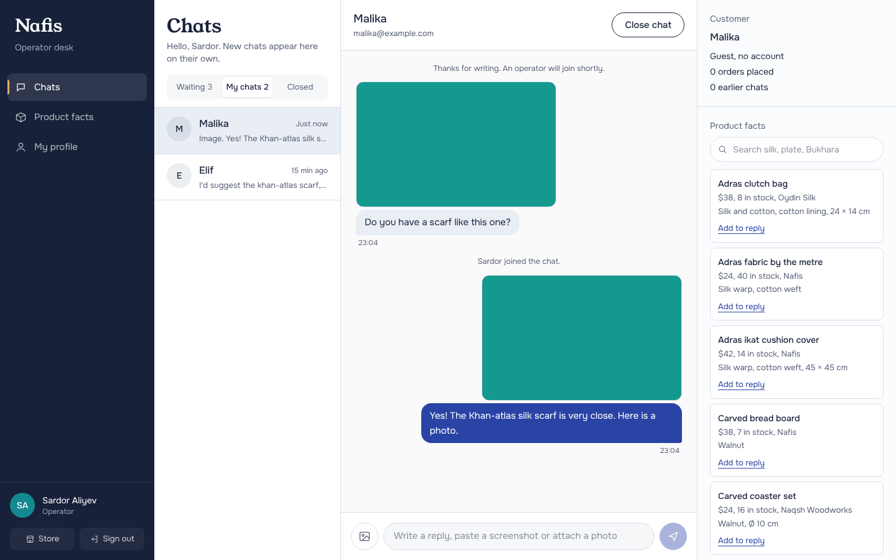
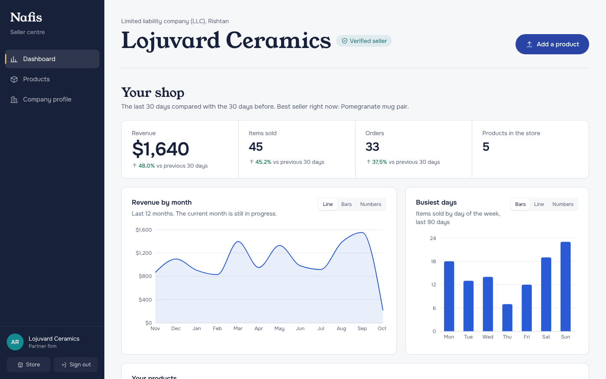
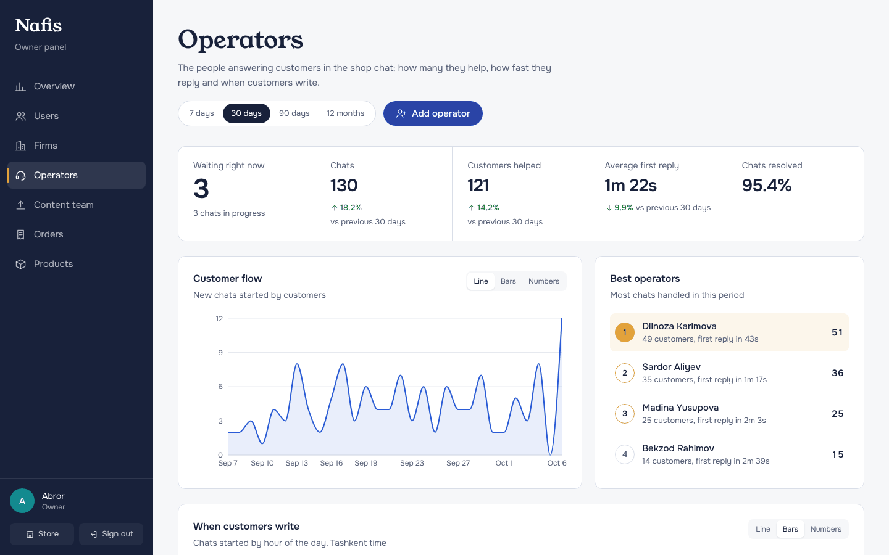
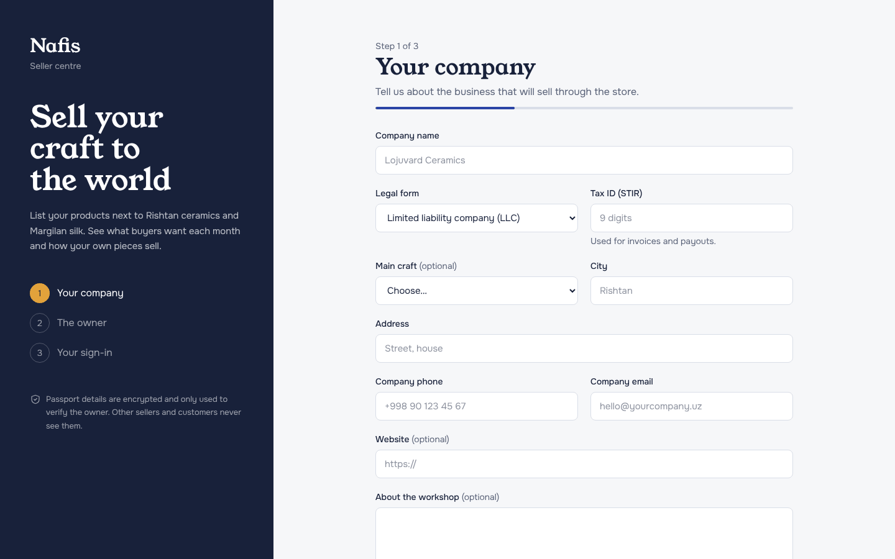
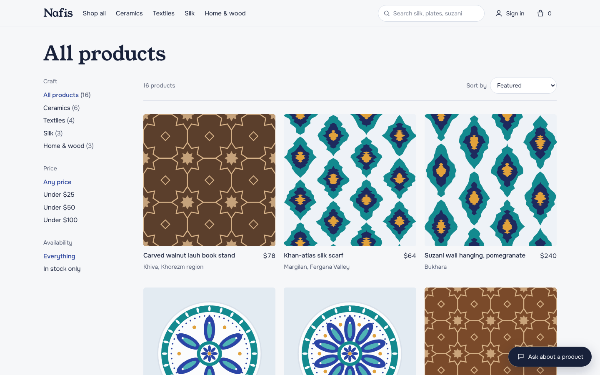
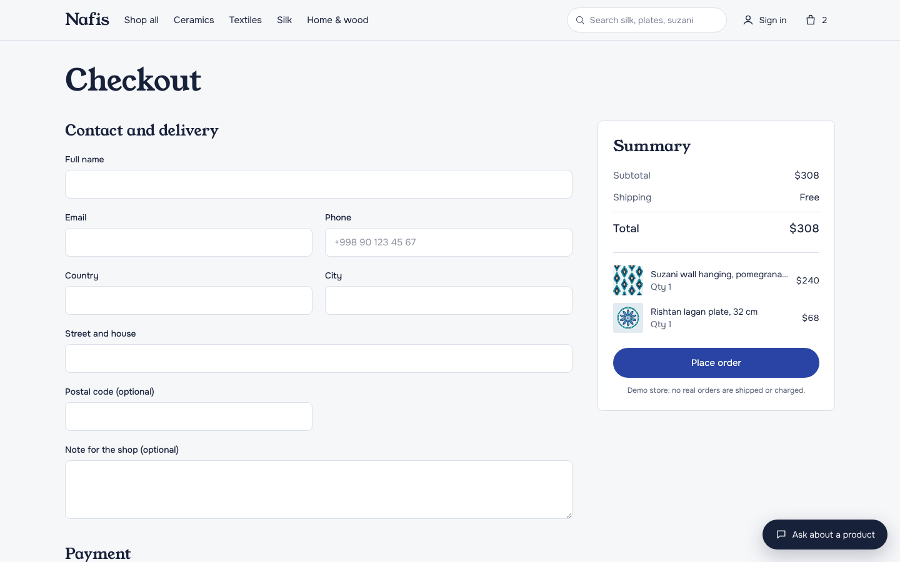

# Nafis: a full-stack marketplace for handmade crafts

An online marketplace for handmade crafts from Uzbekistan (Rishtan ceramics, Margilan silk, suzani and ikat textiles), built with **Django REST Framework**, **Next.js** and **PostgreSQL**.

Shoppers get a complete store: catalog, cart, checkout with card or cash payment, an AI shopping assistant and a live chat with human operators that accepts photos and screenshots. Behind the store there are four separate work panels:

- an **owner panel** with company-wide analytics
- an **operator desk** for the live chat
- a **content desk** for the team that publishes products
- a **seller centre** for partner firms

> Demo project for my portfolio. The brand, people, firms, products and documents are made up, and orders are never shipped or charged.



| Storefront | Product page |
| --- | --- |
|  |  |

| Operator desk: live chat with images | Seller centre for partner firms |
| --- | --- |
|  |  |

| Operator analytics | Seller registration |
| --- | --- |
|  |  |

| Catalog with filters | Checkout |
| --- | --- |
|  |  |

## What's inside

### Storefront
- Catalog with category, price and availability filters, search, sorting and pagination
- Product pages where the price updates with the chosen quantity, plus stock limits and related products
- Persistent cart that re-checks live prices and stock before checkout
- Checkout with field-level validation, card payment (Stripe Checkout) or cash on delivery
- Customer accounts with order history (JWT with refresh tokens)
- **Shop assistant**: AI answers grounded in the live catalog (Claude API), with keyword search as a fallback
- **Live chat with an operator** inside the same widget: guests can chat without an account, attach photos, drag them in or paste screenshots, and get an unread badge when a reply arrives
- Generated product artwork (ceramic plate, ikat and girih patterns) until real photos are uploaded

### Owner panel (`/boss`)
- **Overview**: revenue, orders, items sold, average order and new customers, each compared with the previous period; revenue and order charts; best sellers; revenue by craft; partner firms, operators and the content team at a glance; latest orders
- **Users**: every account with filters by type (customers, firms, operators, editors, owners) and customer health groups: power buyers, active, occasional, signed up but never bought, churned
- **Firms**: firm groups (top sellers, selling well, active with weak sales, signed up without products, left or suspended), leaderboard, revenue and sign-up trends, firm detail with the identity check, verify and suspend actions
- **Operators**: people waiting now, chats, customers helped, average first reply, resolution rate, customer flow by day and by hour, leaderboard with the best operators highlighted, and a form to add operators
- **Content team**: products added today and per period, uploads by day and by craft, leaderboard, a form to add editors
- **Orders** with status changes, and **Products** with show/hide and featured switches
- One time-range filter (7 days, 30 days, 90 days, 12 months) drives every figure on a page
- Every chart can be switched between **line, bars and a numbers table**, and the choice is remembered. Figures count up when they load, and the animation respects reduced-motion settings.

### Operator desk (`/operator`)
- Waiting queue, own chats and closed chats, refreshed automatically
- Take a chat, reply with text and images, close it; colleagues' chats stay private
- Customer card (account, orders, earlier chats) and a product-facts search that inserts a ready-made line into the reply
- Personal statistics: customers served, chats, first-reply time, ranking in the team

### Content desk (`/editor`)
- Products added today, this week and this period, a daily chart and team ranking
- Product form with drag-and-drop photo upload, validation and a live preview of the product card
- Own products list with editing

### Seller centre for firms (`/firm`)
- Separate three-step registration: company details, owner and identity (passport), sign-in
- Dashboard of the firm's own sales: revenue, items, orders, monthly revenue, busiest weekdays, and per-product pace and best month
- Market statistics across the whole store: best sellers now, products cooling off, best seller of each month, demand by craft
- Products are added from a separate page, so the dashboard stays a clean read-only view

## Tech stack

| Layer | Tools |
| --- | --- |
| Frontend | Next.js 16 (App Router), React 19, TypeScript, Tailwind CSS 4, Recharts |
| Backend | Python, Django 5.2 LTS, Django REST Framework, SimpleJWT, django-filter |
| Database | PostgreSQL 16 (SQLite for quick local runs) |
| Payments | Stripe Checkout (test mode) |
| Integrations | Telegram Bot API, Anthropic Claude API |
| Security | Fernet encryption for passport numbers, role-based permissions, rate limiting |
| Infrastructure | Docker, Docker Compose, Gunicorn, WhiteNoise |

## How it fits together

```
Browser ──> Next.js (port 3000) ──/api/*, /media/*──> Django API (port 8000) ──> PostgreSQL
                │                                        │
                └── Server Components fetch the API      ├── Stripe Checkout + webhook
                    directly when rendering pages        ├── Telegram Bot API
                                                         └── Claude API (assistant)
```

The browser only talks to Next.js. Requests to `/api/*` and `/media/*` are proxied to Django, so there is no CORS setup and the same URLs work locally, in Docker and in production.

### Roles

| Role | How the account is created | Where they work |
| --- | --- | --- |
| Owner | `python manage.py createsuperuser` | `/boss` (and Django admin at `/admin` for raw data) |
| Operator | Added by the owner in `/boss/operators` | `/operator` |
| Content editor | Added by the owner in `/boss/editors` | `/editor` |
| Firm owner | Registers at `/firm/register` | `/firm` |
| Customer | Signs up at `/register`, or buys as a guest | The store and `/account` |

Everyone signs in on the same page and lands in their own panel. Operators and editors are not Django staff, so they can't open Django admin, and every panel API checks the role on the server.

## Quick start with Docker

```bash
cp .env.example .env          # optional: set ADMIN_PASSWORD to get an owner account
docker compose up --build
```

- Store: http://localhost:3000
- Owner panel: http://localhost:3000/boss
- Django admin: http://localhost:8000/admin/

Demo data (the catalog plus 12 months of firms, staff, customers, orders and chats) is loaded on first start.

## Local development

Requirements: Python 3.10+ and Node.js 20+.

**Backend**

```bash
cd backend
python -m venv .venv
source .venv/bin/activate        # Windows: .venv\Scripts\activate
pip install -r requirements.txt
cp .env.example .env             # Windows: copy .env.example .env
python manage.py migrate
python manage.py seed_platform   # demo catalog + firms, staff, customers, orders and chats
python manage.py createsuperuser # your owner account
python manage.py runserver
```

On Windows, `.\setup.ps1` inside `backend` does the environment, install, `.env`, migration and demo data steps in one go.

**Frontend** (in a second terminal)

```bash
cd frontend
npm install
cp .env.example .env.local       # Windows: copy .env.example .env.local
npm run dev
```

Open http://localhost:3000.

### Demo accounts

`seed_platform` creates these accounts, all with the password `nafis-demo-2026` (change it with `--password`):

| Role | Email |
| --- | --- |
| Operator | dilnoza.karimova@example.com |
| Content editor | kamola.nazarova@example.com |
| Firm owner | aziz.rasulov.firm@example.com |

## Configuration

All integrations are optional. Without them the store still works: card payment is hidden, notifications are skipped, and the assistant falls back to keyword search.

| Variable | Where | Purpose |
| --- | --- | --- |
| `DJANGO_SECRET_KEY` | backend | Required when `DJANGO_DEBUG=False` |
| `DATABASE_URL` | backend | PostgreSQL URL; empty means SQLite |
| `FIELD_ENCRYPTION_KEY` | backend | Key for encrypting passport numbers (set a fixed one in production) |
| `STRIPE_SECRET_KEY`, `STRIPE_WEBHOOK_SECRET` | backend | Card payments |
| `TELEGRAM_BOT_TOKEN`, `TELEGRAM_ADMIN_CHAT_ID` | backend | Order alerts to the owner |
| `ANTHROPIC_API_KEY`, `AI_MODEL` | backend | AI answers in the assistant |
| `API_URL` | frontend | Where Next.js finds the Django API |
| `NEXT_PUBLIC_STORE_NAME` | frontend | Store name in the header and titles |

### Testing card payments

1. Put a Stripe **test** secret key in `backend/.env`.
2. Forward webhooks with the [Stripe CLI](https://docs.stripe.com/stripe-cli):
   `stripe listen --forward-to localhost:8000/api/payments/stripe/webhook/`
   and copy the printed `whsec_...` value into `STRIPE_WEBHOOK_SECRET`.
3. Pay with card `4242 4242 4242 4242`, any future date and any CVC.

## API overview

| Area | Endpoints |
| --- | --- |
| Catalog | `GET /api/categories/`, `GET /api/products/` (filters `category`, `search`, `min_price`, `max_price`, `in_stock`, `featured`, `ordering`), `GET /api/products/{slug}/` |
| Orders | `POST /api/orders/`, `GET /api/orders/{uuid}/`, `GET /api/orders/mine/`, `POST /api/payments/stripe/webhook/` |
| Accounts | `POST /api/auth/register/`, `/login/`, `/refresh/`, `GET /api/auth/me/` (includes the role and panel) |
| Assistant | `POST /api/assistant/` |
| Live chat (shopper) | `POST /api/support/conversations/`, `GET /api/support/conversations/{token}/?after=`, `POST .../messages/` (text and/or image), `POST .../close/` |
| Operator desk | `/api/operator/me/`, `/api/operator/conversations/?box=waiting\|mine\|closed`, `.../{id}/`, `.../{id}/claim/`, `.../{id}/messages/`, `.../{id}/close/`, `/api/operator/products/` |
| Content desk | `/api/editor/me/`, `/api/editor/products/` (create and edit with photo upload) |
| Seller centre | `POST /api/firms/register/`, `/api/firm/me/`, `/api/firm/stats/`, `/api/firm/products/` |
| Owner panel | `/api/boss/overview/`, `/users/`, `/firms/` (+ detail, verify, suspend, passport reveal), `/operators/`, `/editors/`, `/orders/`, `/products/`; all accept `?range=7d\|30d\|90d\|12m` |

## Tests

```bash
cd backend
python manage.py test           # 55 tests: catalog, orders, payments, auth, assistant, chat, firms, panels

cd frontend
npm run lint && npm run typecheck && npm run build
```

## Security notes

- Order totals are computed from database prices; tampered prices in the request are ignored.
- Quantities are validated against stock inside a database transaction with row locks.
- Each panel API checks the user's role on the server; operators and editors have no Django admin access.
- Operators only see the shared waiting queue and their own chats, never a colleague's open conversation.
- Passport numbers are encrypted at rest (Fernet), shown masked (`AA*****67`), revealed only to the owner on request, and every reveal is written to the audit log.
- Uploaded images are checked to be real images (JPEG, PNG, WebP or GIF, 5 MB max) and stored under random file names.
- Stripe webhooks are rejected unless the signature matches.
- The public order endpoint uses a random UUID and does not return email, phone or address.
- Telegram messages escape customer input before sending.
- Sign-in, sign-up, orders, new chats, chat messages and the assistant are rate limited.

## Project structure

```
backend/
  apps/catalog/     categories, products, editor desk, seed_demo and seed_platform commands
  apps/orders/      orders, checkout service, Stripe, Telegram
  apps/accounts/    sign-up, sign-in, roles and permissions, staff profiles
  apps/firms/       partner firms: registration, profile, products, stats
  apps/support/     live chat for shoppers and the operator desk
  apps/boss/        owner panel API and all statistics (analytics.py)
  apps/assistant/   shopping assistant (Claude API or keyword search)
  apps/core/        encryption and upload helpers
frontend/
  src/app/          store pages, plus boss/, operator/, editor/ and firm/ panels
  src/components/   store UI, panel/ (shell, charts, tables, chat, product form)
  src/lib/          API client, types, formatting
docker-compose.yml
```

## License

[MIT](LICENSE) © 2026 Abror Kushshiyev

## Author

**Abror Kushshiyev**, Python and full-stack developer
[GitHub](https://github.com/Abror5555) · [LinkedIn](https://www.linkedin.com/in/abror-abrorbek)
